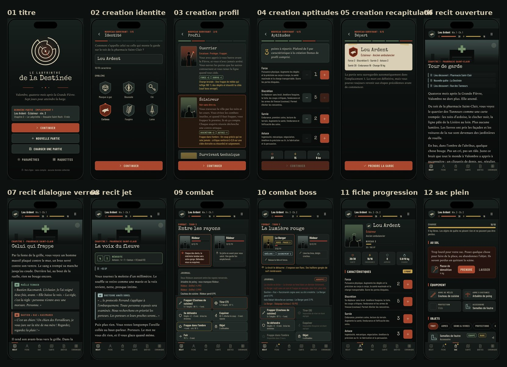
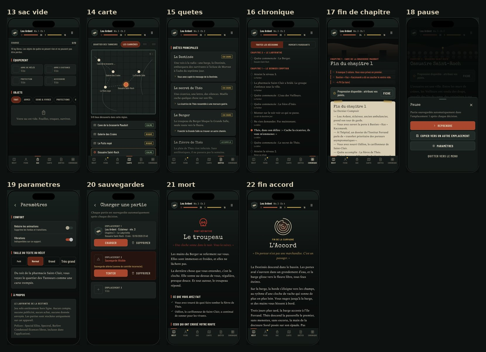
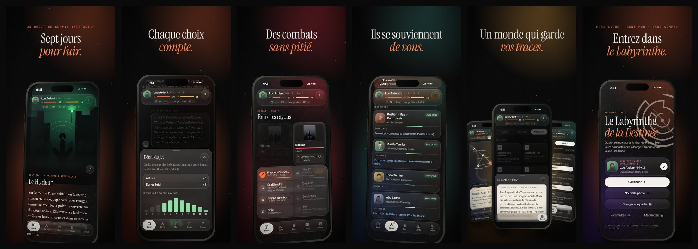

# Le Labyrinthe de la Destinée

Jeu mobile narratif solo de survie horrifique post-apocalyptique, **en français et en anglais**, pour iPhone
(React Native + Expo SDK 57). Entièrement hors ligne : aucun compte, serveur, publicité, achat intégré ni télémétrie.

> Valombre, quatorze mois après la Grande Fièvre. Une voix à la radio annonce qu’une barge, la *Destinée*,
> embarquera des survivants à l’écluse de Morvan à l’aube du septième jour. Pour l’atteindre, il faut traverser
> le Labyrinthe : les carrières sous la ville, le port des Ferrailleurs… et décider de ce que vaut la vie d’un
> enfant que tout le monde veut.



## Lancer le jeu

```bash
npm install
npx expo start            # puis scanner le QR code avec Expo Go sur iPhone
npx expo start --web      # version navigateur (utile pour prévisualiser)
```

Toutes les dépendances natives (AsyncStorage, react-native-svg, expo-linear-gradient, expo-blur, expo-glass-effect,
expo-audio, expo-localization, expo-haptics, expo-font, safe-area-context) sont incluses dans Expo Go SDK 57 :
aucun development build n’est nécessaire.

## Vérifier

| Commande | Rôle |
| --- | --- |
| `npm test` | 131 tests Vitest : moteur, combat, inventaire, horloge, atelier, sauvegardes et migrations, parcours complets, traduction anglaise complète, contraste des couleurs |
| `npm run typecheck` | TypeScript strict |
| `npx expo lint` | ESLint (configuration Expo, règles React Compiler) |
| `npm run validate` | Validateur du contenu narratif |
| `npm run balance [n]` | Lance n parties automatiques par style de jeu et affiche la répartition des fins et des morts |
| `npm run bench` | Banc d’essai des combats (taux de victoire par profil et par rencontre) |
| `npx expo-doctor` | Cohérence de la configuration Expo |
| `python3 scripts/generate-ambience.py` | Régénère les ambiances sonores (synthèse numpy + ffmpeg) |

Une CI GitHub Actions (`.github/workflows/ci.yml`) lance types, lint, tests, validation, équilibrage et export web à chaque push.

## Contenu livré

- **15 chapitres, 393 scènes, 785 choix, environ 62 000 mots** de narration, de dialogues et de choix (plus les
  données du monde : objets, documents, journal…), **intégralement traduits en anglais** (tout est écrit et relié ;
  aucun texte de remplissage). De Valombre à l’écluse : la ville (1), les Carrières (2), les Faubourgs (3), le port
  (4), puis dix étapes sur la route du fleuve (5 à 14 : vergers noyés, rocade du Péage, prieuré, barrage de Vaulx,
  convoi, tourbières, Brennes, draisine, gué de la Sauldre, dernière veillée) et l’écluse de Morvan (15). La durée d’une partie dépend des branches suivies : une seule partie ne parcourt qu’une
  partie du texte.
- **6 fins** (l’Accord, les Capitaines, le Prix du passage, le Gardien de l’écluse, les Racines, le Fleuve) et
  **4 morts définitives** distinctes, chacune avec un épilogue qui dépend des alliés, des quêtes et des décisions.
- **59 rencontres de combat** dont **7 boss** à phases ou comportements propres (Hurleur, Berger, Gaspard Lenoir,
  le Péage, la Dame des tourbières, capitaine Rousset, Colosse de l’écluse).
- **15 personnages** récurrents dont 5 compagnons possibles (épilogues selon la relation), **33 lieux** sur 6 régions
  reliés par de vrais chemins, **15 quêtes**, **46 objets**, **7 recettes**, **34 documents d’archives**, un **journal
  intime** écrit à la fin de chaque chapitre selon ce qui a été vécu.

### Exemples de conséquences différées

- Ouvrir ou non la porte à Kaz au chapitre 1 décide s’il deviendra un allié, un traître (chapitre 3, selon votre
  relation), un Ferrailleur qui vous laisse passer, ou celui qui tiendra la manivelle de l’écluse à la fin.
- Sauver les vivres ou les médicaments dans l’incendie décide si Maëlle, mordue en vous sauvant, survivra à
  l’ossuaire (chapitre 2).
- Nourrir le vieux carillonneur réduit la horde de l’assaut final du chapitre 1 et lui donne une place dans
  l’épilogue des Racines.
- Les preuves réunies (dossier de l’hôpital, carnet de Malik, enregistrement radio, lettre, ordre de mission du
  convoi) conditionnent la confiance de la docteure Sorel, donc la possibilité de l’Accord.
- Rendre le courant au barrage de Vaulx (chapitre 8) ouvre, au chapitre 15, une façon de manœuvrer l’écluse sans
  sacrifier personne ; descendre Claire et Jules de leur toit (chapitre 5) les fait réapparaître devant la grille.

## Systèmes

- **Création du personnage** : nom, emblème (6), profil (Guerrier, Éclaireur, Survivant technique), passé
  (ambulancier, ancien détenu, cataphile, pompier — chacun avec avantage et inconvénient), répartition de 6 points
  (plafond de 5 à la création, 8 ensuite). Les règles sont appliquées par le moteur, pas seulement affichées.
- **Choix narratifs** : conditions (caractéristiques, objets, profil, passé, relations, quêtes, drapeaux, état des
  compagnons…), choix verrouillés avec raison explicite quand le personnage peut la connaître, choix secrets, jets
  2d6 + caractéristique avec probabilité exacte affichée, coûts et risques déduits automatiquement des effets.
- **Progression** : expérience, 6 niveaux, points de caractéristiques, 7 compétences (niveaux 2, 4 et 6).
- **Inventaire** : poids et capacité, piles, 4 emplacements d’équipement, bonus/malus (le plastron de ferraille
  coûte de la discrétion), objets trop lourds laissés « au sol » avec possibilité de faire de la place, objets de
  quête impossibles à perdre, consommables réellement retirés, soins bornés.
- **Combat** : intentions ennemies annoncées (coup lourd → se défendre ; morsure → esquiver), attaque de mêlée ou à
  distance (munitions, armes bruyantes qui attirent des Muets), défense, esquive, compétence de profil, objets
  (Molotov, fusées…), fuite ; statuts (saignement, brûlure, étourdi, distrait, agrippé, sonné, affaibli),
  faiblesses, phases de boss, invocations limitées, aide des compagnons. Infection par morsure, qui s’aggrave à
  chaque chapitre et se soigne aux antibiotiques.
- **Monde persistant** : carte par région révélée progressivement, notes des changements (refuge incendié, pompe
  réparée, cages ouvertes…), relations et statut des personnages, repas du groupe à chaque fin de chapitre.
- **Chronique** de toutes les décisions et récapitulatif de fin (moments marquants, alliés, quêtes, bilan).
- **Horloge des sept jours** : chaque choix coûte du temps ; arriver en retard ferme des portes, très en retard la barge
  est partie. Le temps restant s’affiche dans le bandeau.
- **Atelier et usure** : fabrication (pansements, Molotov, carreaux…), solidité des armes, enrayage des armes à feu
  usées, réparation ; comparaison avec l’équipement porté avant d’équiper.
- **Seconde compétence** par profil au niveau 4 (Rempart, Disparition, Charge improvisée).
- **Choix chronométrés** rares, avec choix de repli annoncé ; désactivables, et toujours désactivés avec VoiceOver.
- **Mort et défaites** : les dégâts narratifs ne tuent jamais par surprise ; seules certaines défaites (boss
  annoncés comme tels, captivité) sont mortelles. Les autres mènent à une blessure, une perte ou une capture.
- **La relève** : quand le personnage meurt, un compagnon jouable qui voyage avec lui (Kaz l’éclusier, Maëlle
  l’infirmière, Inès la passeuse) peut reprendre la route, juste avant le coup fatal. Il garde **sa propre fiche** :
  profil caché avec deux compétences à lui, passé, caractéristiques, talents, équipement, et un niveau qui suit
  l’avancée du voyage (sans dépasser celui du héros tombé). Rien du héros tombé ne lui revient, sauf les objets de
  quête et **ce qu’il prend en fouillant le corps** (trois objets au plus) quand le corps est accessible : certaines
  morts (le troupeau, la cage, l’écluse) ne laissent rien. La partie ne s’arrête que lorsque plus personne ne peut
  reprendre la route. Les tombés restent dans la chronique. En dernier recours, s’il ne reste personne d’autre,
  **Théo** (Cartographe) ou **Nour** (Compteuse) peuvent reprendre la route. Le choix est **confirmé** avant d’être
  appliqué, et l’état de la mort est **mis de côté** : « Avant la relève » (Charger une partie, ou le menu pause)
  permet d’y revenir. La **fiche de relève** de chaque compagnon jouable se consulte à tout moment depuis la Fiche.
  Le récit change quand on joue un compagnon : répliques à la deuxième personne, choix « [Vous, Kaz] », hommage à
  celle ou celui qui est tombé, épilogues propres.
- **Tutoriel** au premier lancement : visite guidée en 13 étapes (récit, choix et probabilités, bandeau, horloge,
  chacun des 5 onglets — Récit, Fiche, Sac, Carte, Carnet —, combats, relève). Chaque étape ouvre l’onglet qu’elle
  présente. On peut le passer, et le revoir dans **Paramètres › Aide › Revoir le tutoriel**. Des **astuces
  contextuelles** apparaissent ensuite une seule fois, quand une mécanique se présente (premier combat, choix
  chronométré, atelier, sac, montée de niveau, relève).
- **Mémoires** (écran titre) : progression commune à toutes les parties, déduite uniquement de ce qui a été joué —
  **21 succès** (hors ligne), **visages** rencontrés, **codex** des ennemis croisés (faiblesses, attaques), et
  **chapitres** : après une première partie terminée, **arbre des choix** de chaque chapitre (scènes vues, choix
  explorés ou non, sans rien révéler de l’inconnu) et **Rejouer un chapitre** depuis le début tel que vous l’aviez
  atteint la dernière fois, dans l’emplacement de votre choix.
- **Indicateur de retard** : l’horloge du bandeau passe à « un peu juste » puis « en retard » quand vous êtes en
  retard sur l’heure à laquelle un voyageur à l’heure entame le chapitre en cours.
- **Rappel de reprise** (facultatif, désactivé par défaut) : une notification **locale** programmée sur l’appareil
  quand on quitte une partie en cours, après 48 h sans jouer ; annulée dès qu’on revient. Aucun serveur.

## Interface (refonte 2026)

- Surfaces de **verre** : Liquid Glass natif sur iOS 26 (`expo-glass-effect`), flou d’arrière-plan ailleurs ;
  bandeau et barre d’onglets **flottants** en pilule ; halos colorés propres à chaque chapitre ; grain béton/papier.
- Typographie éditoriale : Instrument Serif (titres), Newsreader (récit), Inter Tight (interface), JetBrains Mono
  (étiquettes, horloge).
- **Portraits dessinés** de chaque personnage, **illustrations plein écran** aux moments clés, **transitions de
  chapitre**, résumé **« Que s’est-il passé ? »** à la reprise, **détail des jets** en touchant le pourcentage.
- **Accessibilité** : taille de texte iOS respectée (jusqu’à ×1,8 pour le récit), réglage de taille propre au récit,
  contrastes WCAG vérifiés par un test (≥ 4,5:1), animations réductibles, libellés VoiceOver.
- **Ambiance sonore** : huit boucles synthétisées pour le jeu (ville, carrières, faubourgs, port, marais, barrage,
  écluse, combat), choisies par lieu puis par région ; volume réglable, respect du mode silencieux, mélange avec la
  musique de l’utilisateur.
- **Carte** : le chemin réellement parcouru se trace sur la carte de chaque région, jusqu’à la position actuelle.
- **Recherche** dans la chronique et dans les archives (documents et journal intime), sans tenir compte des accents.
- **« Précédemment »** sur le carton de chaque chapitre : les faits marquants du chapitre précédent.
- **Récit sur papier** (option de lecture) : encre sombre sur page claire.
- **18 illustrations** plein cadre, dont une pour chaque chapitre de la route.
- **Langues** : français ou anglais, selon l’appareil ou au choix dans les paramètres. Le moteur reçoit le contenu
  traduit (dictionnaire français → anglais appliqué à tout le contenu, messages du moteur traduits) ; un test vérifie
  que chaque texte a sa traduction.

## Publication

- `eas.json` : profil `preview` (distribution interne, APK Android) et profil `production` (numéro de build
  incrémenté automatiquement, version gérée par EAS). Identifiants : `fr.labyrinthe.destinee` (iOS et Android).
- Icône 1024 × 1024 sans transparence, écran de démarrage et icône adaptative Android fournis ;
  `usesNonExemptEncryption: false` ; `npx expo-doctor` : 21/21.
- Commandes : `npx eas-cli@latest build --profile production --platform ios` puis
  `npx eas-cli@latest submit --platform ios` (un compte Expo et un compte Apple Developer sont nécessaires).

## Sauvegardes

- 3 emplacements ; chaque partie se sauvegarde automatiquement **après chaque décision, action de combat ou
  changement d’inventaire**, et à la mise en arrière-plan.
- Enveloppe versionnée (`schemaVersion`) avec **somme de contrôle** ; avant d’écraser une sauvegarde valide, elle
  est copiée en **secours** ; avant une relève, l’état de la mort est gardé à part (« Avant la relève ») ; au chargement : vérification, **migration** (v1 → v2 → v3 → v4 incluses et testées),
  validation/réparation (objets inconnus retirés, scène disparue → début du chapitre, combat relancé).
- **File d’écriture** : jamais deux écritures concurrentes, les rafales sont fusionnées.
- Nouvelle partie dans un emplacement occupé, suppression et copie : **confirmation explicite**. Le RNG est stocké
  dans la sauvegarde : recharger ne permet pas de relancer un jet.

## Maquettes

L’application contient une **galerie de 27 maquettes** (menu principal → *Maquettes*) : ce sont les vrais écrans,
rendus dans un cadre iPhone 390 × 844 avec des états produits par le moteur. Exports dans
[`docs/maquettes/`](docs/maquettes) (versions anglaises préfixées `en-`) :




## Vidéo de présentation et captures App Store

Une **App Store Preview de 30 s** (français et anglais) et **6 captures App Store** par langue, réalisées à partir
des **vrais écrans de l’application**, filmés image par image puis mis en scène dans un iPhone 3D avec l’identité
visuelle du jeu. Détails, storyboard et commandes : [`promo/README.md`](promo/README.md).

| | |
| --- | --- |
| Vidéo | [`docs/promo/app-preview-fr.mp4`](docs/promo/app-preview-fr.mp4) · [`app-preview-en.mp4`](docs/promo/app-preview-en.mp4) (886 × 1920, 30 i/s, H.264 + AAC) |
| Captures | [`docs/appstore/fr/`](docs/appstore/fr) · [`docs/appstore/en/`](docs/appstore/en) (1290 × 2796) |



## Architecture

```
index.ts                     point d’entrée Expo
app.json                     configuration (thème sombre, icône, splash via expo-splash-screen)
assets/                      icône, splash, icônes Android (générés depuis l’emblème)
src/
  App.tsx                    polices locales, zones de sécurité, garde-fou d’erreur, AsyncStorage
  AppRouter.tsx              routeur à état (l’écran découle du modèle)
  engine/                    moteur pur TypeScript, sans dépendance d’interface
    types.ts                 modèles (scènes, conditions, effets, objets, ennemis, état de partie)
    rules.ts                 constantes d’équilibrage (source de vérité unique)
    rng.ts                   aléatoire déterministe stocké dans la sauvegarde
    character.ts             création, statistiques dérivées, progression
    conditions.ts            évaluation et explication des conditions
    effects.ts               application centralisée des effets
    inventory.ts             poids, piles, équipement, consommables, objets au sol
    narrative.ts             nouvelle partie, scènes, choix, jets, routage, sortie de combat
    relay.ts                 la relève : compagnons candidats, fiche du nouveau héros, fouille du corps
    combat.ts                combat au tour par tour
    summary.ts               récapitulatif de fin
    validator.ts             validateur de contenu
    simulate.ts              joueurs automatiques (tests et équilibrage)
  content/                   données narratives (aucune logique)
    chapters/                scènes des 15 chapitres (c1, c2, fb, c3, r1 … r10, c4)
    heroes.ts                fiches des compagnons jouables (relève)
    world.ts                 profils, passés, compétences, personnages, lieux, quêtes, chapitres, fins
    items.ts, enemies.ts, summary.ts, helpers.ts, index.ts
  persistence/               stockage, format, migrations, emplacements
  store/GameStore.tsx        pont moteur ↔ interface, autosauvegarde, paramètres
  ui/                        design system : jetons, verre, icônes, portraits, illustrations, composants
  i18n/                      textes d’interface (fr, en) et choix de la langue
  audio/                     ambiance sonore (choix de la piste, lecteur)
  content/en/                traductions anglaises du contenu et des messages du moteur
  screens/                   écrans (titre, création, jeu et ses vues, sauvegardes, paramètres)
  gallery/                   galerie de maquettes et états de démonstration
  promo/PromoRoot.tsx        mode capture (web) utilisé pour filmer la vidéo
promo/                       vidéo App Store Preview : capture, scène, bande-son, rendu
tests/                       tests Vitest
scripts/                     validation du contenu, équilibrage, banc de combat
docs/maquettes/              exports des maquettes
```

**Ajouter un chapitre** : écrire ses scènes dans `src/content/chapters/`, déclarer le chapitre dans `CHAPTERS`
(`world.ts`) et l’ajouter à `src/content/index.ts`. Aucun écran n’est à modifier ; le validateur signale toute
destination, référence ou fin manquante.

**Choix de navigation** : plutôt qu’Expo Router, l’application utilise un routeur à état. Un jeu a un seul « lieu »
véritable — l’état de partie — et les onglets (fiche, sac, carte…) ne doivent jamais faire perdre la position dans
l’histoire. Faire découler l’écran du modèle rend impossible une désynchronisation entre la pile de navigation et
la partie (retour arrière Android géré explicitement : onglet → récit → pause).

## Résultats obtenus

- `npm test` : **145/145 tests réussis** (dont des parties automatiques complètes en français et en anglais).
- `npm run validate` : 396 scènes, 825 choix, 10 fins, **0 erreur, 0 avertissement**.
- `npm run typecheck`, `npx expo lint`, `npx expo-doctor` (21/21) : **aucun problème**.
- Export web puis parcours automatisé dans Chromium au format iPhone : création, choix, combat, onglets,
  **rechargement et reprise** avec résumé : aucune erreur console. Les 32 maquettes se rendent sans erreur, en
  français et en anglais.

## Limites connues

- Le jeu n’a pas pu être lancé sur un iPhone ni un simulateur iOS dans cet environnement (Linux) : la validation
  visuelle a été faite sur le build web au format iPhone. Un essai sur appareil via Expo Go reste à faire
  (haptique et rendu natif des polices en particulier).
- L’équilibrage repose sur des joueurs automatiques ; il mérite des sessions de jeu humaines.
- L’ambiance sonore est désactivée dans la version web (codec AAC et lecture automatique non garantis par les
  navigateurs) ; elle est jouée sur iOS et Android.
- Changer de langue en cours de partie traduit tout le contenu, mais l’historique déjà écrit (chronique, notes)
  reste dans la langue où il a été vécu.
- Le Liquid Glass natif n’apparaît que sur iOS 26 ; en dessous, le verre est rendu par un flou classique.
- Le fichier `LICENSE` est celui du modèle `create-expo-app` ; à remplacer selon la licence souhaitée pour le jeu.
