# Le Labyrinthe de la Destinée

Jeu mobile narratif solo de survie horrifique post-apocalyptique, en français, pour iPhone (React Native + Expo SDK 57).
Entièrement hors ligne : aucun compte, serveur, publicité, achat intégré ni télémétrie.

> Valombre, quatorze mois après la Grande Fièvre. Une voix à la radio annonce qu’une barge, la *Destinée*,
> embarquera des survivants à l’écluse de Morvan à l’aube du septième jour. Pour l’atteindre, il faut traverser
> le Labyrinthe : les carrières sous la ville, le port des Ferrailleurs… et décider de ce que vaut la vie d’un
> enfant que tout le monde veut.

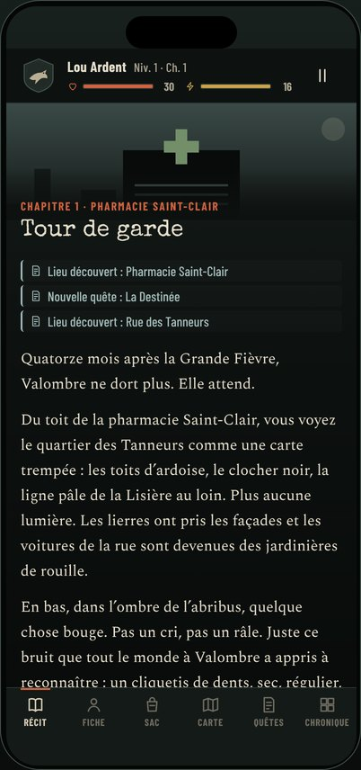

## Lancer le jeu

```bash
npm install
npx expo start            # puis scanner le QR code avec Expo Go sur iPhone
npx expo start --web      # version navigateur (utile pour prévisualiser)
```

Toutes les dépendances natives (AsyncStorage, react-native-svg, expo-linear-gradient, expo-haptics,
expo-font, safe-area-context) sont incluses dans Expo Go SDK 57 : aucun development build n’est nécessaire.

## Vérifier

| Commande | Rôle |
| --- | --- |
| `npm test` | 98 tests Vitest : moteur, combat, inventaire, quêtes, sauvegardes, migrations, corruption, parcours complets |
| `npm run typecheck` | TypeScript strict |
| `npx expo lint` | ESLint (configuration Expo, règles React Compiler) |
| `npm run validate` | Validateur du contenu narratif |
| `npm run balance [n]` | Lance n parties automatiques par style de jeu et affiche la répartition des fins et des morts |
| `npm run bench` | Banc d’essai des combats (taux de victoire par profil et par rencontre) |
| `npx expo-doctor` | Cohérence de la configuration Expo |

## Contenu livré

- **4 chapitres, 149 scènes, 259 choix, environ 16 000 mots** de narration et de dialogues (tout est écrit et relié ;
  aucun texte de remplissage). La durée d’une partie dépend des branches suivies : une seule partie ne parcourt qu’une
  partie du texte.
- **6 fins** (l’Accord, les Capitaines, le Prix du passage, le Gardien de l’écluse, les Racines, le Fleuve) et
  **4 morts définitives** distinctes, chacune avec un épilogue qui dépend des alliés, des quêtes et des décisions.
- **24 rencontres de combat** dont **6 boss** à phases ou comportements propres (Hurleur, Berger, Gaspard Lenoir,
  capitaine Rousset, Colosse de l’écluse).
- **11 personnages** récurrents dont 5 compagnons possibles, **20 lieux** sur 4 régions, **10 quêtes**, **39 objets**.

### Exemples de conséquences différées

- Ouvrir ou non la porte à Kaz au chapitre 1 décide s’il deviendra un allié, un traître (chapitre 3, selon votre
  relation), un Ferrailleur qui vous laisse passer, ou celui qui tiendra la manivelle de l’écluse à la fin.
- Sauver les vivres ou les médicaments dans l’incendie décide si Maëlle, mordue en vous sauvant, survivra à
  l’ossuaire (chapitre 2).
- Nourrir le vieux carillonneur réduit la horde de l’assaut final du chapitre 1 et lui donne une place dans
  l’épilogue des Racines.
- Les preuves réunies (dossier de l’hôpital, carnet de Malik, enregistrement radio, lettre) conditionnent la
  confiance de la docteure Sorel, donc la possibilité de l’Accord.

## Systèmes

- **Création du personnage** : nom, emblème (6), profil (Guerrier, Éclaireur, Survivant technique), passé
  (ambulancier, ancien détenu, cataphile, pompier — chacun avec avantage et inconvénient), répartition de 6 points
  (plafond de 5 à la création, 8 ensuite). Les règles sont appliquées par le moteur, pas seulement affichées.
- **Choix narratifs** : conditions (caractéristiques, objets, profil, passé, relations, quêtes, drapeaux, état des
  compagnons…), choix verrouillés avec raison explicite quand le personnage peut la connaître, choix secrets, jets
  2d6 + caractéristique avec probabilité exacte affichée, coûts et risques déduits automatiquement des effets.
- **Progression** : expérience, 6 niveaux, points de caractéristiques, 7 compétences (niveaux 2, 4 et 6).
- **Inventaire** : poids et capacité, piles, 4 emplacements d’équipement, bonus/malus (le plastron de ferraille
  coûte de la discrétion), objets trop lourds laissés « au sol » avec possibilité de faire de la place, objets de
  quête impossibles à perdre, consommables réellement retirés, soins bornés.
- **Combat** : intentions ennemies annoncées (coup lourd → se défendre ; morsure → esquiver), attaque de mêlée ou à
  distance (munitions, armes bruyantes qui attirent des Muets), défense, esquive, compétence de profil, objets
  (Molotov, fusées…), fuite ; statuts (saignement, brûlure, étourdi, distrait, agrippé, sonné, affaibli),
  faiblesses, phases de boss, invocations limitées, aide des compagnons. Infection par morsure, qui s’aggrave à
  chaque chapitre et se soigne aux antibiotiques.
- **Monde persistant** : carte par région révélée progressivement, notes des changements (refuge incendié, pompe
  réparée, cages ouvertes…), relations et statut des personnages, repas du groupe à chaque fin de chapitre.
- **Chronique** de toutes les décisions et récapitulatif de fin (moments marquants, alliés, quêtes, bilan).
- **Mort et défaites** : les dégâts narratifs ne tuent jamais par surprise ; seules certaines défaites (boss
  annoncés comme tels, captivité) sont mortelles. Les autres mènent à une blessure, une perte ou une capture.

## Sauvegardes

- 3 emplacements ; chaque partie se sauvegarde automatiquement **après chaque décision, action de combat ou
  changement d’inventaire**, et à la mise en arrière-plan.
- Enveloppe versionnée (`schemaVersion`) avec **somme de contrôle** ; avant d’écraser une sauvegarde valide, elle
  est copiée en **secours** ; au chargement : vérification, **migration** (v1 → v2 incluse et testée),
  validation/réparation (objets inconnus retirés, scène disparue → début du chapitre, combat relancé).
- **File d’écriture** : jamais deux écritures concurrentes, les rafales sont fusionnées.
- Nouvelle partie dans un emplacement occupé, suppression et copie : **confirmation explicite**. Le RNG est stocké
  dans la sauvegarde : recharger ne permet pas de relancer un jet.

## Maquettes

L’application contient une **galerie de 22 maquettes** (menu principal → *Maquettes*) : ce sont les vrais écrans,
rendus dans un cadre iPhone 390 × 844 avec des états produits par le moteur. Exports dans
[`docs/maquettes/`](docs/maquettes) :

| | | | |
| --- | --- | --- | --- |
|  | 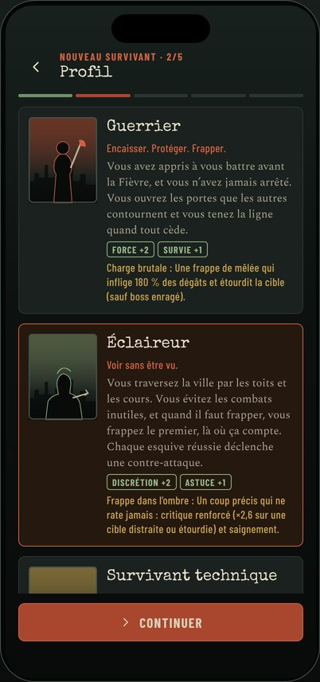 | 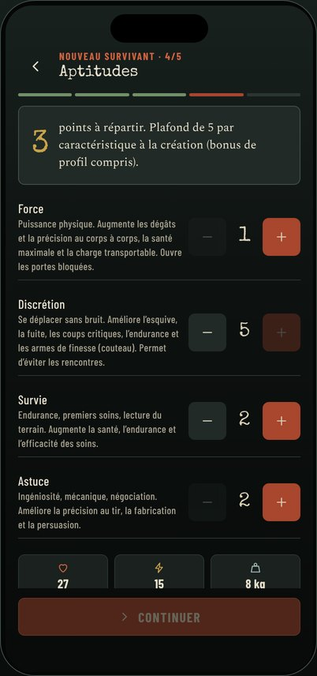 |  |
| 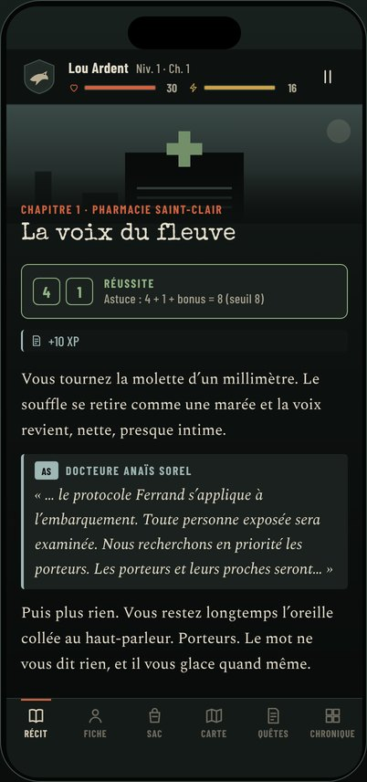 | 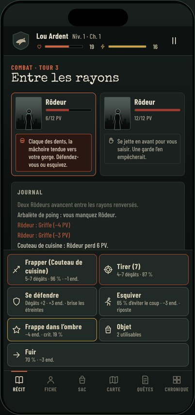 | 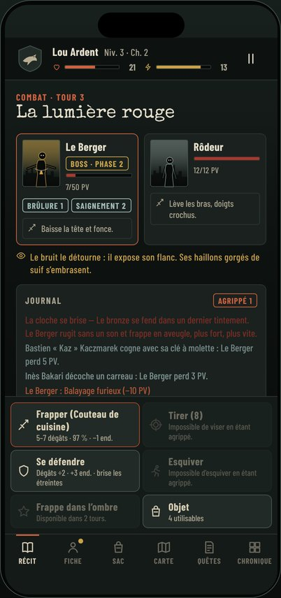 | 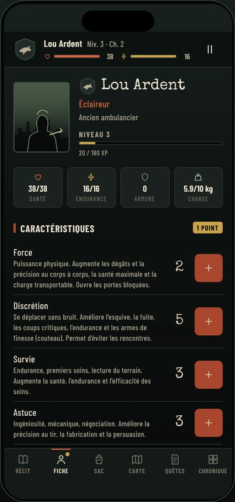 |
| 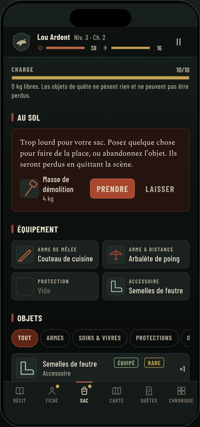 | 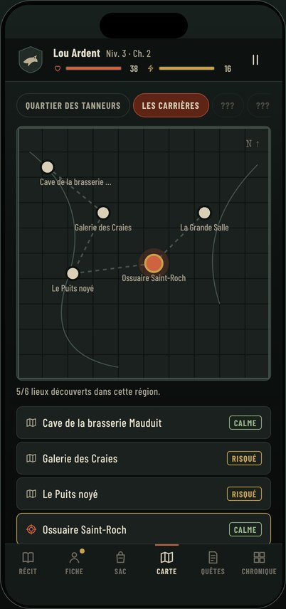 | 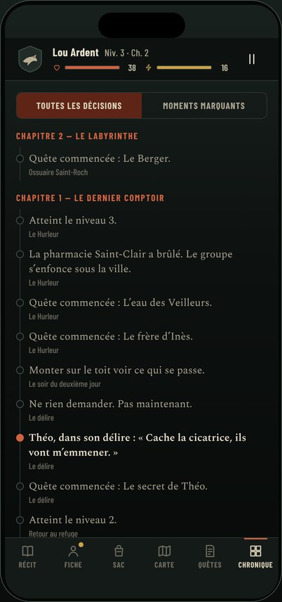 | 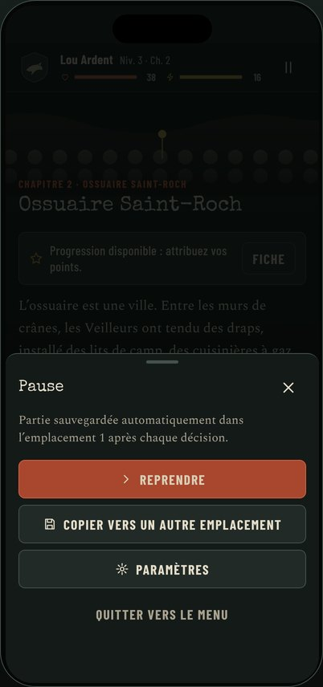 |
| 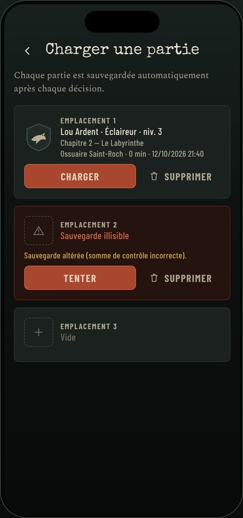 | 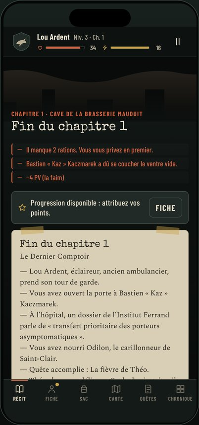 | 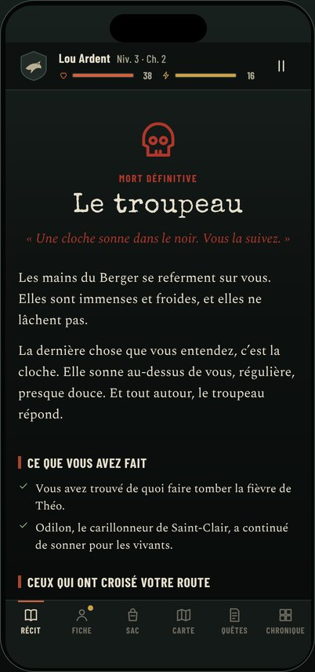 | 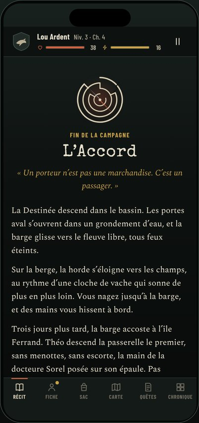 |

## Architecture

```
index.ts                     point d’entrée Expo
app.json                     configuration (thème sombre, icône, splash via expo-splash-screen)
assets/                      icône, splash, icônes Android (générés depuis l’emblème)
src/
  App.tsx                    polices locales, zones de sécurité, garde-fou d’erreur, AsyncStorage
  AppRouter.tsx              routeur à état (l’écran découle du modèle)
  engine/                    moteur pur TypeScript, sans dépendance d’interface
    types.ts                 modèles (scènes, conditions, effets, objets, ennemis, état de partie)
    rules.ts                 constantes d’équilibrage (source de vérité unique)
    rng.ts                   aléatoire déterministe stocké dans la sauvegarde
    character.ts             création, statistiques dérivées, progression
    conditions.ts            évaluation et explication des conditions
    effects.ts               application centralisée des effets
    inventory.ts             poids, piles, équipement, consommables, objets au sol
    narrative.ts             nouvelle partie, scènes, choix, jets, routage, sortie de combat
    combat.ts                combat au tour par tour
    summary.ts               récapitulatif de fin
    validator.ts             validateur de contenu
    simulate.ts              joueurs automatiques (tests et équilibrage)
  content/                   données narratives (aucune logique)
    chapters/c1.ts … c4.ts   scènes des 4 chapitres
    world.ts                 profils, passés, compétences, personnages, lieux, quêtes, chapitres, fins
    items.ts, enemies.ts, summary.ts, helpers.ts, index.ts
  persistence/               stockage, format, migrations, emplacements
  store/GameStore.tsx        pont moteur ↔ interface, autosauvegarde, paramètres
  ui/                        design system : thème, icônes, illustrations SVG, composants
  screens/                   écrans (titre, création, jeu et ses vues, sauvegardes, paramètres)
  gallery/                   galerie de maquettes et états de démonstration
tests/                       tests Vitest
scripts/                     validation du contenu, équilibrage, banc de combat
docs/maquettes/              exports des maquettes
```

**Ajouter un chapitre** : écrire ses scènes dans `src/content/chapters/`, déclarer le chapitre dans `CHAPTERS`
(`world.ts`) et l’ajouter à `src/content/index.ts`. Aucun écran n’est à modifier ; le validateur signale toute
destination, référence ou fin manquante.

**Choix de navigation** : plutôt qu’Expo Router, l’application utilise un routeur à état. Un jeu a un seul « lieu »
véritable — l’état de partie — et les onglets (fiche, sac, carte…) ne doivent jamais faire perdre la position dans
l’histoire. Faire découler l’écran du modèle rend impossible une désynchronisation entre la pile de navigation et
la partie (retour arrière Android géré explicitement : onglet → récit → pause).

## Résultats obtenus

- `npm test` : **98/98 tests réussis** (dont 125 parties automatiques complètes sans blocage, les 9 fins non
  génériques atteintes avec le vrai moteur, et 4 parcours scénarisés : Accord, Prix du passage, Kaz Ferrailleur,
  Racines).
- `npm run validate` : 149 scènes, 259 choix, **0 erreur, 0 avertissement**.
- `npm run typecheck`, `npx expo lint`, `npx expo-doctor` (21/21) : **aucun problème**.
- Export web (`npx expo export --platform web`) puis parcours automatisé dans Chromium au format iPhone :
  création d’un personnage, choix, combat, consultation des onglets, **rechargement de la page et reprise à la même
  scène** : aucune erreur console. Les 22 maquettes se rendent sans erreur.
- Banc de combat : selon la préparation, un joueur « compétent » gagne 60 à 95 % des combats de boss avec chacun des
  trois profils (voir `npm run bench`).

## Limites connues

- Le jeu n’a pas pu être lancé sur un iPhone ni un simulateur iOS dans cet environnement (Linux) : la validation
  visuelle a été faite sur le build web au format iPhone. Un essai sur appareil via Expo Go reste à faire
  (haptique et rendu natif des polices en particulier).
- L’équilibrage repose sur des joueurs automatiques ; il mérite des sessions de jeu humaines.
- Aucun son n’est intégré : il n’y a donc pas de réglage audio.
- Le fichier `LICENSE` est celui du modèle `create-expo-app` ; à remplacer selon la licence souhaitée pour le jeu.
